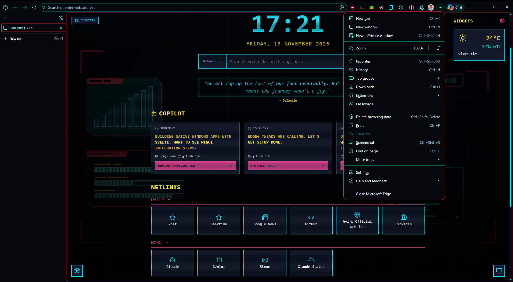

# Cyberpunk 2077 themes

Two Edge themes in the Cyberpunk UX kit's red, cyan and teal, each a [WXT](https://wxt.dev) extension.



| Package          | Theme                |
| ---------------- | -------------------- |
| `packages/dark`  | Cyberpunk 2077 Dark  |
| `packages/light` | Cyberpunk 2077 Light |

## Build

```
pnpm install
pnpm ext:build   # packages/<theme>/dist/chrome-mv3, load it unpacked
pnpm ext:zip
```

A theme has no code: each package's `manifest.json` is the whole theme (colours, tints, images) and `public/images/` holds the frame and new tab pictures. `wxt.config.ts` feeds that manifest to WXT.
